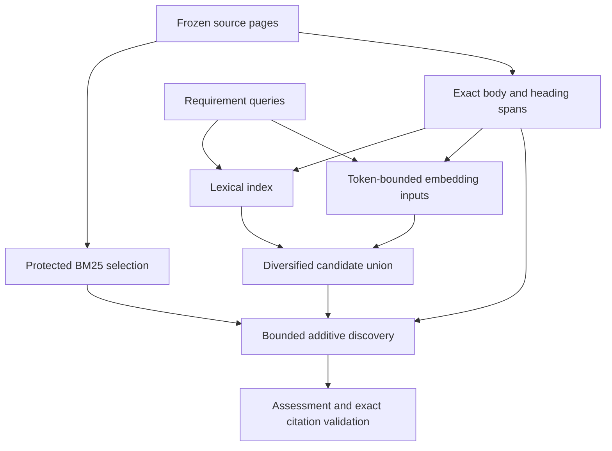

# ADR: source-grounded passage retrieval for A1

Status: implemented as an explicitly selected experimental hybrid. BM25 remains the operational default.

## Findings and limits

The private reference diagnostic found that source passages and tokenizer inputs retained the labelled evidence, but semantic ranking often favoured upload instructions and generic headings. The fixed half-budget allocation then displaced useful lexical evidence. That diagnosis justifies correcting allocation and discovery quality; it does not establish that the current encoder is adequate or that a stronger model would improve this corpus.

The full private corpus and institutional measurements stay outside the repository. Existing inspected labels are a regression set. Plans versus operation, scope, period and contradiction require evidence assessment, not a cosine threshold.

## Alternatives

- A larger encoder alone leaves broken passage boundaries, missing headings and packing unchanged. Retain provisioned BGE-small initially; diagnose its actual inputs before a model replacement.
- More weighted RRF alone addresses neither representation nor independent requirement coverage.
- A cross-encoder adds another artifact and inference stage. Defer until candidate recall and selection diagnostics show a useful candidate set that it could improve.
- A vector database adds operations and persistence without a scale/concurrency requirement. A deterministic per-execution passage store and matrix cache suffice for the current corpus.
- Hosted embeddings expose institutional evidence to another service. They are not introduced.

## Selected architecture

Keep deployed BM25 unchanged as the operational control. Explicit hybrid uses a separate source-grounded pipeline:

1. Construct a reusable page-local passage store independent of indicators. Split prose at paragraph/sentence boundaries; group table rows under their actual rendered header. Use the provisioned tokenizer with padding/truncation disabled for construction, targeting 240 tokens and enforcing the model's actual input limit with a 32-token safety margin. Split oversized units by real token offsets with bounded overlap. Preserve every body span as an exact original page slice.
2. Keep retrieval text separate from citable text. Embeddings may prepend the actual local section/table heading. Each heading carries its own source offset; a table also carries its preceding page-local section/period heading. Final packets include those original heading spans, charged to the same budget; synthetic embedding strings are never citable quotations. Page-local headings do not fabricate cross-page context.
3. Generate a small deterministic query set per requirement. Preserve the assertion; resolve demonstrative/pronominal references with the immediately preceding assertion. Every one of the 216 current requirements has a reviewed evidence-record description in retrieval_profiles_v1.json. Pair that description with the assertion (contextualised where needed); both receive a query slot. The profiles list alternative source record types and aliases, never additional pass criteria. Validate exact coverage and assertion text, freeze the profile version/checksum and reject mismatches. Use profile vocabulary with a modest separate lexical weight, while keeping assertion terms primary. Do not prepend the broad indicator title to every assertion. No hosted query generation. For English BGE v1.5, add its documented retrieval-query instruction only to queries. FastEmbed 0.9.1's generic ONNX adapter does not add that instruction. The [official model card](https://huggingface.co/BAAI/bge-small-en-v1.5) also says v1.5 can work without it: omission is not proof of the reference regression. Freeze and expose the actual encoder query strings. Other model families retain their native FastEmbed query encoding.
4. Rank the same passage store lexically and semantically. Lexical scoring separates assertion/context terms, low-weight curated indicator terms and bounded extraction hints. Diagnostics expose raw and boosted scores/ranks. Exclude instruction-only upload tables, response stubs and bare numbered headings from discovery before shortlisting; retain them in the frozen source and protected BM25 selection. Encode eligible passages once per execution; normalized matrix multiplication ranks all passages for each cached query. Same-page exact/contained-span consolidation precedes fusion; partially overlapping passages keep their unique tails, while final merging charges only unique characters. Cross-page copies retain independent provenance because their scopes or periods may differ. Semantic ranking finds relevance, not truth or readiness credit.
5. Protect the entire existing BM25 selection at its 18,000-character allowance before discovery. This includes its existing window behaviour; there is no claim that the baseline itself contains only complete sentences. Hybrid adds a separate 6,000-character maximum discovery allowance, for a total packet limit of 24,000. At a supplied total budget of 18,000 it preserves the BM25 selection without semantic displacement. No fixed half-budget allocation remains. Semantic discovery gets one novel candidate opportunity per requirement, then lexical/profile and semantic RRF candidates compete for the remainder (2:1, k=60). Only positive lexical/similarity scores contribute their route's rank. Complete new body/heading spans pay their exact additional character cost; discovery never evicts the baseline or clips bodies to fit. This guarantees baseline character preservation, not semantic relevance or an improvement over BM25 at 24,000. Record exclusions, baseline and expansion characters, and packing outcomes.
6. Expand small retrieved bodies to their construction unit, not arbitrary neighbouring text; heading spans preserve interpretive context. Exact source IDs/offsets pass unchanged to current citation/review validators and the evaluator. Semantic component failure fails the frozen hybrid execution; it never silently substitutes BM25.

## Flow

## Costs and constraints

This adds deterministic passage/tokenizer work and a per-execution vector matrix; corpus text and vectors stay local. The store is reused across all indicators and recommendation batches within that execution, not across institutions or mutable documents. There is no persistent index. Stable content hashes bind cache identity to source text and offsets.

Table rendering still depends on ingestion: absent/incorrect cells or headers cannot be recovered downstream. Oversized individual rows may need token splits; diagnostics expose that limitation. Source-period interpretation and relevance-versus-entailment remain evaluator responsibilities. The preceding-assertion anchor is an exposed retrieval heuristic, not a guaranteed pronoun-resolution result. The original rubric assertion still controls assessment. The baseline retention contract protects supplied lexical text, not the correctness of its rankings. Additional discovery can still be irrelevant; the original encoder remains a hypothesis to test. The existing labels are a debugging/regression set, not a fresh holdout.

## Verification and release

Test token-dense text, oversized units, row/header retention, reference-resolving queries, exact quotation provenance, independent requirement coverage, deduplication, bounded packing, input-change cache invalidation and explicit semantic failures. Run the real provisioned model offline, the scoring/recommendation suites and backend suite. Retain PR16's per-item recommendation repair and origin labels.

Extend private offline comparison with raw/boosted BM25 ranks, semantic similarities/query variants, exact encoder input/token counts, headings/body offsets, packing outcomes, candidate-vs-packet recall, gain/loss item identities and timing/cache statistics. Add readable per-item and aggregate traces. Report observed stages separately from hypotheses requiring manual relevance judgement.

The SWE must run reference comparisons on the private corpus at both budgets, including BM25 at the same expanded budget, inspect prose/table gains and losses and manually judge representative false semantic matches. Do not promote hybrid or claim institutional recall improvement from synthetic tests. Keep Gemini integration separate from encoder evaluation; it remains the agreed evaluator/extraction/recommendation provider choice, not a retrieval fix.

Verification results and exact test counts are recorded in the PR. The real-encoder dense-numeric test demonstrates that a 1,200-character string can exceed the encoder limit, while constructed inputs remain untruncated and reuse their vectors. These are implementation contracts, not private reference recall measurements. PostgreSQL and frontend CI remain merge requirements.

## Evidence-seeking profiles follow-up

The empty rubric evidence-query/example fields left assertion wording as the primary query language. A separate versioned profile pack now covers all 216 assertions, with descriptions of relevant source records (budgets, registers, computing access, curricula, governance decisions, outcome comparisons and follow-up checks). Each profile is bound to the exact assertion text. General enabling capacity remains general: computer access does not become AI adoption, and IQAC/academic reviews do not require this product. Source records are alternatives, not mandatory document titles.

The paired query design reserves one slot for the profile and one for the assertion; referential assertions cannot consume both slots and starve the profile. Lexical traces expose the profile contribution separately from contextual assertion scores, indicator terms and extraction hints. The frozen policy includes the profile checksum, and the retrieval protocol version changes with the new query policy. No scoring thresholds, rubric assertions, provider configuration or frontend contracts change.

These are manually authored retrieval descriptions, not a domain-trained relevance model. They can still retrieve plans or irrelevant topical matches; existing assessment/citation checks determine what the evidence establishes. The private regression run must inspect profile-versus-assertion rankings and gained/lost evidence before any hybrid promotion.

The offline comparison retains `profiled_bm25` as an unprotected lexical passage/profile ablation. Expanded methods compare protected profile-only discovery, protected hybrid discovery, and BM25 at the same larger budget. This distinguishes profile gains, semantic gains and extra-context gains. The comparison fails if a protected method loses baseline gold evidence. `--include-replay-inputs` includes the complete private frozen source/rubric/gold inputs in its outside-repository JSON output for independent offline replay. It adds no live retrieval mode and makes no evaluator calls.

## Caption and diagnostic correction

A rendered table caption is not disposable metadata: its column cells can carry
substantive narrative. Filter version 2 removes only the generated wrapper when
classifying that payload, preserves original citable offsets, and tests both
caption-only narratives and oversized split captions. Do not infer semantic
quality from passing these structure tests.

The offline comparison now supports private replay without database access,
per-requirement versus cross-requirement candidate pools (with pool sizes), and
a label-aware packet-feasibility check. A budget-rejection observation does not
establish that context capacity caused the miss. Relevant quotation counts,
distinct requirements reached, and independently adjudicated decision truth are
reported separately. Multiple alternative quotations for one requirement never
become multiple demonstrated requirements.

ONNX telemetry is disabled before local model initialization. Offline callers
should also set ORT_DISABLE_TELEMETRY=1 before process launch and keep model
downloads disabled. These corrections do not promote hybrid or change BM25's
operational default.
